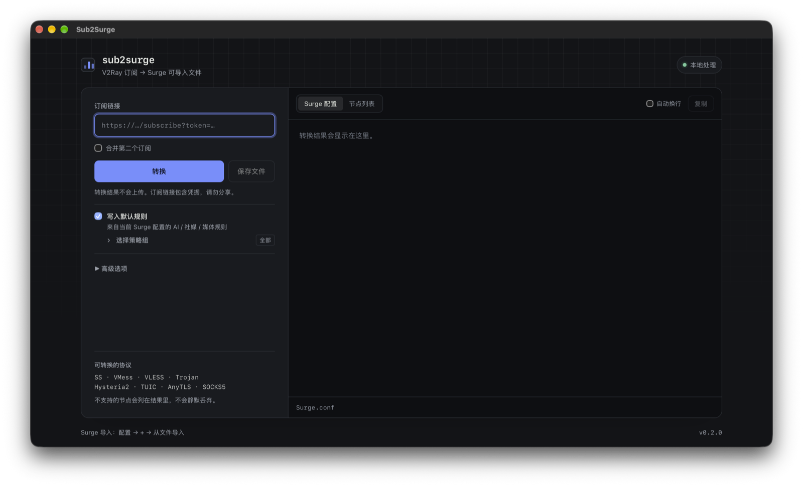

# sub2surge

[](https://github.com/yesvichu/sub2surge/actions/workflows/ci.yml)

把 **v2ray 订阅链接** 转成 **Surge 可导入的 `.conf` 文件 / 节点列表**。



三种形态共用同一套转换内核：

- **CLI**：`-out Surge.conf` 直接生成文件
- **HTTP**：`/sub` 给 Surge 的 `policy-path` 用
- **桌面应用**：MyGo 窗口，粘贴链接、转换、保存（`desktop/`）

它是参考 [Sub-Store](https://github.com/sub-store-org/Sub-Store) 的架构做的“最小可用版”：

```
上游订阅 (base64 / URI 列表)
        │
        ▼
  parser  ── 解析 vmess/vless/trojan/ss/hysteria2/tuic/anytls/socks5
        │       （内部统一成 mihomo 风格的节点模型）
        ▼
 pipeline  ── 过滤 / 改名 / 排序 / 去重 / 生成唯一名字
        │
        ▼
 producer  ── 输出 Surge [Proxy] 行
        │
        ├── surgefile ── 完整 .conf（[General] + [Proxy] + [Proxy Group] + [Rule]）
        ├── HTTP /sub ── policy-path 节点列表
        └── MyGo 桌面窗口 ── 预览 + 原生保存对话框
```

和 Sub-Store 的区别：只做 **v2ray URI 订阅 → Surge** 这一条链路，不解析 Clash YAML、不做规则转换、不内置 Web 管理后台、不带 Gist 同步和脚本系统。好处是单二进制、零依赖、逻辑可读。

---

## 快速开始

需要 Go 1.24+。

```bash
# 直接跑（默认监听 127.0.0.1:8080）
go run . -url 'https://example.com/api/v1/client/subscribe?token=xxx'

# 或者先看转换结果，不启动服务
go run . -url 'https://example.com/api/v1/client/subscribe?token=xxx' -once

# 构建
go build -trimpath -ldflags="-s -w" -o sub2surge .

# 直接生成 Surge 可导入的配置文件
./sub2surge -url 'https://你的机场订阅地址' -out Surge.conf

# 写到标准输出
./sub2surge -url 'https://你的机场订阅地址' -out -

# 合并两个订阅（节点名会带上来源标签）
./sub2surge -url 'https://a.example/sub' -url2 'https://b.example/sub' \
  -label1 '机场A' -label2 '机场B' -out Surge-merged.conf
```

合并后节点名形如：

```text
机场A - 香港 01
机场B - 日本 02
```

生成的 `Surge.conf` 结构：

```ini
[General]
loglevel = notify

[Proxy]
节点1=vmess,...
节点2=vless,...

[Proxy Group]
🔰国外流量 = select, 节点1, 节点2
🚀直接连接 = select, DIRECT
...

[Rule]
PROCESS-NAME,CloudflareWARP,🚀直接连接
PROCESS-NAME,"Cloudflare WARP",🚀直接连接

# ---- 🇨🇳国产AI ----
DOMAIN-SUFFIX,deepseek.com,🇨🇳国产AI
...
# ---- 🤖国外AI ----
DOMAIN-SUFFIX,openai.com,🤖国外AI
...
# ---- 💬社媒 / ✈️Telegram / 🎬媒体 ----
...
GEOIP,CN,🚀直接连接
FINAL,⚓️其他流量
```

默认会写入从当前 Surge 配置导出的规则；不想要规则时：

```bash
./sub2surge -url '...' -out Surge.conf -rules none
```

这时 `[Rule]` 只保留 `FINAL,DIRECT`，不生成任何策略组。

导入方式：Surge → 配置 → + → 从文件导入。只想把节点并进现有配置时，用 `-once` 输出 `[Proxy]` 行，或使用桌面端的「节点列表」。

### 默认规则

默认规则来自当前 Surge 配置（`surge-cli dump rule` + 本地 RULE-SET），构建时已经把 RULE-SET **展开成内联规则**，所以生成的 `.conf` 不依赖：

```text
~/Library/Application Support/Surge/Rulesets/...
```

当前包含：

- `PROCESS-NAME` CloudflareWARP / Cloudflare WARP → 🚀直接连接（取消该组时回退 `DIRECT`；仅 macOS 生效）
- 🇨🇳国产AI → 直连组
- 🤖国外AI → 代理组
- 💬社媒 / ✈️Telegram / 🎬Youtube / 🎬Netflix / 🎬国外媒体 → 代理组
- 🎬哔哩哔哩 / 🍎苹果服务 → 直连组
- 🔰国外流量 → 所有转换后的节点
- 🚀直接连接 → `DIRECT`
- `GEOIP,CN` → 🚀直接连接
- `FINAL` → ⚓️其他流量

`GEOIP,CN` 和规则集里的 IP 规则会统一放到所有域名规则之后（`[Rule]` 末尾），避免 Surge 在域名规则前触发不必要的 DNS；`GEOIP,CN` 只保留一条。

规则集快照放在 `internal/surgefile/rulesets/*.list`。Surge 里的规则更新后，替换这些文件并重新构建（或让我重新读取一次）即可。

桌面端在「写入默认规则」下面有「选择策略组」二级菜单，默认全选，也可以逐个取消或「全不选」：

| ID | 策略组 | 说明 |
| --- | --- | --- |
| `cn-ai` | 🇨🇳 国产 AI | 国产 AI 直连 |
| `foreign-ai` | 🤖 国外 AI | OpenAI / Claude / Gemini 等 |
| `social` | 💬 社媒 | X / Discord / TikTok 等 |
| `telegram` | ✈️ Telegram | Telegram 域名与 IP |
| `youtube` | 🎬 YouTube | YouTube / Google Video |
| `netflix` | 🎬 Netflix | Netflix 域名与 IP |
| `foreign-media` | 🎬 国外媒体 | Spotify / Twitch 等 |
| `bilibili` | 🎬 哔哩哔哩 | 哔哩哔哩直连 |
| `apple` | 🍎 苹果服务 | Apple 服务直连 |
| `foreign` | 🔰 国外流量 | 基础代理组：所有节点 |
| `direct` | 🚀 直接连接 | 基础直连组 + 局域网规则 |
| `other` | ⚓️ 其他流量 | FINAL 兜底组 |

自由搭配时的兜底逻辑：

- 取消某个分类组：对应的规则集和策略组都不写入
- 取消 `🔰国外流量`：引用它的策略组改为直接列出所有节点
- 取消 `🚀直接连接`：相关规则改用内建 `DIRECT`
- 取消 `⚓️其他流量`：`FINAL` 回退到 `🔰国外流量`；如果 `🔰国外流量` 也取消，则回退 `DIRECT`
- 全不选：仍保留 `PROCESS-NAME`、`GEOIP,CN` 直连和 `FINAL` 兜底

不需要任何默认规则时，直接取消「写入默认规则」或使用 `-rules none`；这时 `[Rule]` 只有 `FINAL,DIRECT`，也不会生成策略组。

CLI 可以用 `-groups` 只选其中几个：

```bash
# 只要国产 AI + Telegram
./sub2surge -url '...' -out Surge.conf -groups cn-ai,telegram

# 全不选（只保留基础规则）
./sub2surge -url '...' -out Surge.conf -groups none
```

HTTP 的 `format=profile` 对应 `?groups=...`；`rules=none` 仍然是完全不要规则。

Docker：

```bash
docker build -t sub2surge .
docker run --rm -p 127.0.0.1:8080:8080 \
  -e SUB2SURGE_URL='https://example.com/api/v1/client/subscribe?token=xxx' \
  -e SUB2SURGE_TOKEN='change-me' \
  sub2surge
```

容器内默认监听 `0.0.0.0:8080`，所以只把端口发布到本机回环地址，或务必设置 token。

启动后：

- 策略列表：`http://127.0.0.1:8080/sub`
- 预览（JSON，不含密码/UUID）：`http://127.0.0.1:8080/preview`
- 健康检查：`http://127.0.0.1:8080/healthz`

---

## 桌面应用（MyGo）

`desktop/` 是一个 [MyGo](https://github.com/egoist/mygo) 应用：粘贴链接、转换、预览、原生保存。

```bash
cd desktop
go run .                 # 直接运行
go tool mygo dev         # MyGo 开发模式
go tool mygo build       # 打包 .app / .dmg
```

要求 Go 1.27.3+（MyGo 的要求）。前端是内嵌的静态 HTML/CSS/JS，不需要 Bun 或 Vite。

界面里可以：

- 填订阅链接，点「转换」；结果实时显示
- 在「Surge 配置」和「节点列表」之间切换
- 查看跳过的节点和原因
- 勾选「合并第二个订阅」，填写两个来源标签和第二条链接，节点名会变成「标签 - 原名」
- 勾选/取消「写入默认规则」（默认勾选）
- 展开「选择策略组」二级菜单，逐个选择要写入的策略组；支持全选/全不选
- 「保存文件」打开系统原生保存对话框

构建产物在 `desktop/build/darwin-arm64/`（macOS arm64）。

---

## 在 Surge 里使用

### 方式 A：policy-path（推荐，不改动现有配置）

在 Surge 配置的 `[Proxy Group]` 中加一个组，从本服务拉节点列表：

```ini
[Proxy Group]
Sub-Store = url-test, policy-path=http://127.0.0.1:8080/sub, interval=600, update-interval=3600, url=http://www.gstatic.com/generate_204
```

如果开了 token：

```ini
Sub-Store = url-test, policy-path=http://127.0.0.1:8080/sub?token=YOUR_TOKEN, interval=600, update-interval=3600, url=http://www.gstatic.com/generate_204
```

Surge 会定期重新下载 `policy-path`，空白行和以 `#` / `//` 开头的行会被忽略，所以列表里的注释不会影响解析。

> 如果 Surge 在另一台设备上（比如 iPhone 连 Mac），需要让服务监听局域网地址，例如 `-listen 0.0.0.0:8080`，把 `127.0.0.1` 换成 Mac 的局域网 IP，并务必设置 token（见“安全”一节）。

### 方式 B：整份托管配置

```text
http://127.0.0.1:8080/sub?format=profile
```

返回内容以 `#!MANAGED-CONFIG` 开头，包含 `[Proxy]`、`[Proxy Group]`、`[Rule]`，可以直接在 Surge 里作为托管配置导入。

⚠️ 这会替换你当前的 Surge 配置，导入前先备份。日常更推荐方式 A。

`format=profile` 生成 `[Rule]` 只有 `FINAL,DIRECT`（带默认规则时为 `FINAL,⚓️其他流量`），不包含你的分流规则；需要完整规则请把 `[Proxy]` 部分复制进现有配置，或继续用方式 A。

---

## 支持范围

### 上游格式

| 输入 | 说明 |
| --- | --- |
| v2ray URI 列表 | base64 编码或逐行 URI（v2rayN 等订阅的标准形态） |
| Clash / mihomo YAML | 读取顶层 `proxies:` 列表，按下面的协议表转换；不读 `proxy-groups` / `rules` |
| Surge / Shadowrocket 配置 | 读取 `[Proxy]` 段；两者共用这套语法，所以 Shadowrocket 的配置可直接投进来 |

Clash 或 Surge 内容本身是 base64 也能识别（部分机场会这样封装）。

### 协议

| 上游 URI / 节点类型 | Surge 输出 | 说明 |
| --- | --- | --- |
| `ss://` | ✅ | SIP002 / 传统全 base64；simple-obfs (`obfs=http/tls`)；shadow-tls；AES-GCM/2022/流加密白名单 |
| `vmess://` | ✅ | TCP / WebSocket；AEAD；TLS；不支持 gRPC、H2、HTTPUpgrade、REALITY |
| `vless://` | ✅ | **Surge iOS 6.0+ / Mac 6.12+**；TCP/WS/gRPC、TLS、REALITY、Vision |
| `trojan://` | ✅ | TCP / WebSocket；TLS 隐式，不输出 `tls=true` |
| `hysteria2://` / `hy2://` | ✅ | 密码、SNI、跳过证书校验、`salamander`/`gecko` obfs、端口跳跃 |
| `tuic://` | ✅ | v4 token（`tuic`）/ v5 uuid+password（`tuic-v5`）、ALPN、端口跳跃 |
| `anytls://` | ✅ | **Surge iOS 5.17+ / Mac 6.4.3+** |
| `socks5://` / `socks5+tls://` | ✅ | 用户名/密码、TLS、UDP |
| `ssr://` | ❌ | Surge 不原生支持（Sub-Store 用 SurgeMac + mihomo external 绕过） |
| `hysteria://` | ❌ | Surge 只支持 Hysteria2 |
| `wireguard://` | ❌ | 需要 Surge WireGuard 配置/模块，不是 URI 能表达的 |
| `http(s)://` | ❌ | 这是网页链接，不是节点 URI |

不支持的节点不会让整个转换失败：它们会出现在 `/sub` 的注释里、`/preview` 的 `skipped` 数组中，并带上原因。

### 强制开关

- `?udp=1`：给支持 UDP 的节点加 `udp-relay=true`
- `?tfo=1`：加 `tfo=true`
- `?insecure=1`：所有 TLS 节点加 `skip-cert-verify=true`（REALITY 除外）

---

## 配置

单条订阅可以直接用 `-url`。多条订阅用 JSON 配置：

```bash
./sub2surge -config config.json
```

```json
{
  "listen": "127.0.0.1:8080",
  "token": "",
  "default_ua": "v2rayN/6.31",
  "cache_ttl": "1h",
  "subscriptions": [
    {
      "name": "default",
      "url": "https://example.com/api/v1/client/subscribe?token=REPLACE_ME",
      "ua": "v2rayN/6.31",
      "prefix": "",
      "filter": "",
      "exclude": "",
      "sort": false,
      "insecure": false,
      "udp": false,
      "tfo": false
    },
    {
      "name": "backup",
      "url": "https://another.example.com/sub?token=REPLACE_ME",
      "prefix": "B-"
    }
  ]
}
```

- `name` 会出现在路由里：`/sub/default`、`/sub/backup`
- 只有一个订阅且 `name` 为空时，自动叫 `default`，同时服务 `/`、`/sub`
- `filter` / `exclude` 是节点名正则；`prefix` 会加在名字前
- `sort` 按名字排序；`insecure` / `udp` / `tfo` 是全局开关
- `cache_ttl` 只影响上游缓存，不改变 Surge 拉取到的内容

### 环境变量

| 变量 | 说明 |
| --- | --- |
| `SUB2SURGE_CONFIG` | 配置文件路径 |
| `SUB2SURGE_URL` | 单条订阅 URL（会覆盖配置文件里的订阅） |
| `SUB2SURGE_LISTEN` | 监听地址，默认 `127.0.0.1:8080` |
| `SUB2SURGE_UA` | 拉取上游时使用的 User-Agent |
| `SUB2SURGE_TOKEN` | 访问 `/sub`、`/preview` 需要的 token |
| `SUB2SURGE_CACHE_TTL` | 上游缓存时间，如 `1h`、`30m` |

优先级：配置文件 < 环境变量 < 显式命令行参数。

---

### 文件输出

| 参数 | 说明 |
| --- | --- |
| `-out FILE` | 生成完整 Surge `.conf` 并写入文件；`-out -` 写到 stdout |
| `-url2 URL` | 第二个订阅，和 `-url` 合并（配合 `-out` / `-once`） |
| `-label1` / `-label2` | 合并时的来源标签，默认 `订阅 A` / `订阅 B` |
| `-managed-url URL` | 配合 `-out`，在文件头加 `#!MANAGED-CONFIG URL`，变成 Surge 托管配置 |
| `-rules default\|none` | 配合 `-out`，是否写入默认规则（默认 `default`） |
| `-groups all\|none\|ID,...` | 配合 `-out`，选择要写入的策略组（默认 `all`） |
| `-once` | 只输出 `[Proxy]` 行到 stdout |

---

## 合并订阅

把两条订阅合并成一份输出，每个节点名前面加上来源标签：

```bash
./sub2surge -url 'https://a.example/sub' -url2 'https://b.example/sub' \
  -label1 '机场A' -label2 '机场B' -out Surge-merged.conf
```

规则：

- 节点名格式为 `来源标签 - 原节点名`
- 两个标签不能相同（默认 `订阅 A` / `订阅 B`）
- 完全相同的节点（协议、地址、端口、凭据一致）只保留第一次出现的那个
- 某个来源拉取/解析失败时，报错会带上来源标签

桌面端勾选「合并第二个订阅」即可；HTTP 可以用：

```text
/sub?url2=https%3A%2F%2Fb.example%2Fsub&label1=机场A&label2=机场B
```

这里配置里的订阅作为来源 A。

---

## HTTP 接口

| 路径 | 说明 |
| --- | --- |
| `GET /`、`GET /sub` | 默认订阅的 Surge 策略列表 |
| `GET /sub/{name}` | 指定订阅 |
| `GET /preview`、`GET /preview/{name}` | JSON 预览；不含 UUID/密码，只标记是否存在 |
| `GET /healthz` | 健康检查（不需要 token） |

### 查询参数

| 参数 | 示例 | 说明 |
| --- | --- | --- |
| `target` | `surge` | 仅接受 Surge；传其他值返回 400（防止误用） |
| `format` | `list` / `profile` | 默认 `list`（policy-path 用）；`profile` 输出完整托管配置 |
| `rules` | `none` | `format=profile` 时关闭默认规则，只保留 `FINAL,DIRECT` |
| `groups` | `all` / `none` / `cn-ai,telegram` | `format=profile` 时选择策略组；默认全部 |
| `url2` | `https://…` | 和配置里的订阅合并，节点名带来源标签 |
| `label1` / `label2` | `机场A` / `机场B` | 合并时两个来源的标签 |
| `token` | `xxx` | 也可用 `Authorization: Bearer xxx` |
| `ua` | `v2rayN/6.31` | 本次拉取上游使用的 UA |
| `noCache` | `1` | 跳过缓存，强制回源 |
| `prefix` | `🇭🇰 ` | 给节点名加前缀 |
| `filter` / `exclude` | `HK|US` | 按名字正则保留/排除 |
| `rename` | `US=>United States` | 可重复；`regex=>replacement` |
| `sort` | `1` | 按名字排序 |
| `insecure` | `1` | 全局跳过证书校验 |
| `udp` / `tfo` | `1` | 全局打开 UDP / TFO |

---

## 缓存、超时与“定时预热”

- 上游响应默认缓存 1 小时（`cache_ttl`），key 是 `URL + User-Agent`
- 多个并发请求会合并成一次回源
- 回源失败时，如果缓存里还有旧数据，会继续返回旧数据（`X-Sub2Surge-Cache: stale`）
- 整体请求超时 50 秒；Surge 客户端自己的超时通常更短，所以机场很慢时建议：
  1. 用 `curl 'http://127.0.0.1:8080/sub?noCache=1'` 定时预热（cron / systemd timer）
  2. 或让 Surge 用较长的 `timeout`（如果你在 policy-path 所在的环境里能设置）

响应头里会带：

```
X-Sub2Surge-Count: 42
X-Sub2Surge-Skipped: 3
X-Sub2Surge-Cache: hit|miss|stale
```

---

## 安全

- 订阅链接本身就是**凭据**（里面通常带机场 token），不要提交到 git、不要发到公开群
- 默认只监听 `127.0.0.1`。监听 `0.0.0.0` 且没有 token 时，启动日志会打警告
- `/preview` 只返回节点名、协议、服务器、端口、SNI 等元信息，不返回 UUID/密码
- 访问日志只记录路径，不记录 query string（避免 token 进日志）
- 默认**不开启 CORS**：随机网页不能直接读取本机后端（Sub-Store 也是通过 CORS allowlist 解决这个问题）
- 暴露到公网时，建议放在 Caddy/Nginx 后面加 HTTPS，并设置 `SUB2SURGE_TOKEN`
- 注意：使用 `format=profile` 时，`#!MANAGED-CONFIG` 会写入当前请求 URL（包括 query 里的 token），Surge 才能自动刷新；如果不想让 token 出现在配置文件里，请改用 `Authorization` 头 + 反向代理注入

---

## 与 Sub-Store 的对应关系

| Sub-Store | 本项目 |
| --- | --- |
| `backend/src/core/proxy-utils/parsers` | `internal/parser` |
| `backend/src/core/proxy-utils/processors` | `internal/pipeline` |
| `backend/src/core/proxy-utils/producers` | `internal/producer` |
| `/download/:name`、UA 自动识别目标 | `/sub/:name`，固定 Surge，`?target=surge` 显式声明 |
| 无桌面端 | `desktop/` MyGo 应用 |
| 远程订阅缓存 1 小时 | `cache_ttl` + 并发合并 + stale 回退 |
| `includeUnsupportedProxy` | 不静默丢弃：写进注释 / `skipped` |
| 前端 PWA + 多订阅管理 | 无前端，JSON 配置 + 路由 |
| Gist/GitLab 同步、定时任务 | 未内置；用 cron + `curl /sub?noCache=1` 预热 |
| 分享 token / AGE 加密 | 仅后端 token；未实现 AGE |
| 脚本操作（JS） | 未实现；需要复杂加工时请继续用 Sub-Store |

---

## 开发

```bash
go test ./...
go vet ./...
gofmt -l .
```

Lint 用 [golangci-lint](https://golangci-lint.run/) v2，配置在 `.golangci.yml`。
`desktop/` 是独立 module，需要单独跑一遍：

```bash
golangci-lint run ./...
cd desktop && golangci-lint run ./...
```

启用的检查里有两项和「现代 Go」相关：`modernize`（对应
[JetBrains/go-modern-guidelines](https://github.com/JetBrains/go-modern-guidelines)）
和 `revive`（已废弃的 golint 的继任者）。新增代码请按所声明的 Go 版本使用
对应惯用法，例如 `slices.SortStableFunc`、`strings.Cut`、`max`、`t.Context()`。

目录：

```
main.go                    命令行参数 / 配置加载 / 优雅退出
internal/config            配置模型与校验
internal/model             统一节点模型
internal/parser            订阅解码 + 各协议 URI 解析
internal/pipeline          过滤、改名、排序、去重、唯一化
internal/producer          Surge 输出
internal/surgefile         完整 .conf / 节点列表渲染
internal/convert           parse → process → produce 的统一入口
internal/source            上游拉取、缓存、并发合并
internal/server            HTTP 路由、鉴权、预览、profile 渲染
internal/version           版本号
desktop/                   MyGo 桌面应用（独立 Go module）
```

### 已知限制

- 只读 Clash 的 `proxies:` 和 Surge/Shadowrocket 的 `[Proxy]`；不转换策略组与规则，`proxy-providers` 里的远程节点也不会展开
- Clash 的 `v2ray-plugin`、`gost-plugin` 插件以及 `snell`、`http` 节点没有 Surge 对应写法，会被列入跳过
- 只输出 Surge，不输出 Clash/Loon/QX
- 桌面端支持 macOS 12+ / Windows 10+ / Linux（GTK3），以 MyGo 的支持范围为准
- 不做规则/策略组/分流转换
- 缓存只在内存里，重启即失效
- 单进程单实例；没有多用户/多租户
- VLESS 的 XHTTP、HTTPUpgrade、mKCP 以及非 `none` 的 VLESS Encryption 不支持（Surge 本身也不支持）

---

## 参考

- Sub-Store：<https://github.com/sub-store-org/Sub-Store>
- Surge 手册（Proxy / Policy Including）：<https://manual.nssurge.com/>
- 各协议 URI 规范：v2rayN、SIP002、Hysteria2、TUIC、AnyTLS 文档
