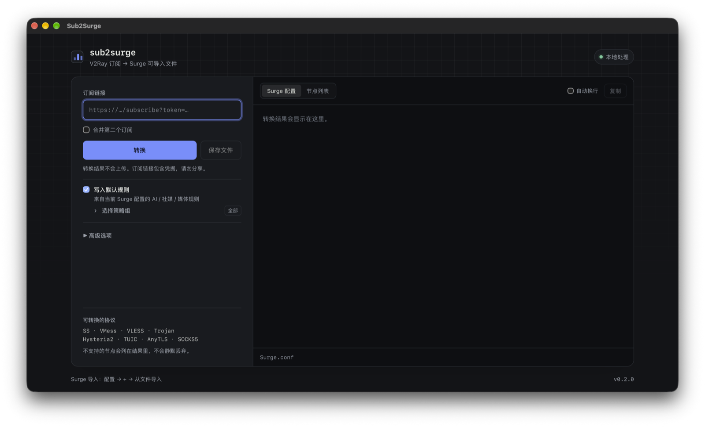

# Sub2Surge Desktop

用 [MyGo](https://github.com/egoist/mygo) 做的桌面端：粘贴 V2Ray 订阅链接，转换成 Surge 可导入的 `.conf` 文件，或只导出节点列表。



界面是内嵌的静态 HTML/CSS/JS（`web/`），通过 `mygo.Bind` 调用 Go 侧的 `Converter` 服务；转换逻辑复用上级模块的 `internal/convert`，和 CLI/HTTP 完全一致。

## 运行

需要 Go 1.27.3+（MyGo 的要求）。不需要 Bun 或 Vite，前端是直接 `go:embed` 的。

```bash
cd desktop
go run .
```

或者用 MyGo CLI（`go.mod` 里已经声明为 tool）：

```bash
go tool mygo dev     # 开发模式，改 Go 会重启
go tool mygo build   # 打包 .app / .dmg
```

构建产物：

```
build/darwin-arm64/Sub2Surge.app
build/darwin-arm64/sub2surge-0.2.0-arm64.dmg
```

`mygo.json` 里配置了应用名、identifier 和版本；`web/` 是全部前端资源。

## 使用

1. 填入订阅链接，点「转换」；需要合并时勾选「合并第二个订阅」，填写两个来源标签和第二条链接。节点名会变成「标签 - 原名」；两个标签不能相同。
2. 在右侧检查结果；不支持的节点会列在「查看跳过的节点」里。
3. 「写入默认规则」默认勾选：使用从当前 Surge 配置导出的 AI / 社媒 / 媒体 / 直连规则（已展开 RULE-SET，不依赖本地文件）。下方「选择策略组」二级菜单默认全选，可以逐个取消或全不选；取消整个默认规则后 `[Rule]` 只保留 `FINAL,DIRECT`，也不会生成策略组。
4. 「历史记录」会自动保存每次**成功**的订阅拉取（包含合并订阅），最多 50 条。展开后点击任意一条即可回填当时的订阅地址、标签和输出选项，再点「转换」就能更新订阅；右侧 × 可删除单条，也可以清空全部。历史保存在本机应用数据目录的 `history.json`（仅当前用户可读），不会上传。
5. 「写入 Surge 并生效」：一键把结果写进 **当前启用** 的 Surge 配置并让它热重载，不需要再手动复制粘贴或替换文件。

   流程是：先用 `surge-cli --check` 校验这份配置（校验不过就完全不碰现网配置）→ 把原配置备份到 `~/Library/Application Support/Sub2Surge/surge-backups/`（保留最近 10 份）→ 写入 `~/Library/Application Support/Surge/Profiles/<当前配置>.conf` → 执行 `surge-cli reload`，只应用变化的段落，现有连接、缓存和临时规则都不会被打断。

   按钮旁的「当前配置」来自 `surge-cli profile current`。如果那份配置**不是** Sub2Surge 生成的（没有 `# Generated by sub2surge` 头），会先弹窗确认，避免整份覆盖手写配置。Surge 未安装或 CLI 找不到时按钮不可用，并会说明原因。

   找不到 CLI 时可以用 `SURGE_CLI` 环境变量指定路径，默认查 `/Applications/Surge.app/Contents/Applications/surge-cli`。
6. 「保存文件」会打开原生保存对话框：
   - **Surge 配置**：`Surge.conf`，包含 `[General]`、`[Proxy]`、`[Proxy Group]`、`[Rule]`，可直接在 Surge 里「配置 → + → 从文件导入」。导入会作为一份新配置使用；想保留现有规则，请改用「节点列表」把节点粘贴进已有配置。
   - **节点列表**：`surge-nodes.txt`，只有 `[Proxy]` 行，适合粘贴进已有配置或放到 `policy-path` 指向的位置。

## 注意

- 订阅链接包含机场凭据，只在本机请求，不会上传。
- 桌面端和 CLI 使用同一个 `convert` 包，所以协议支持、跳过原因、Surge 语法保持一致。
- MyGo 还在快速迭代；升级 `github.com/egoist/mygo` 后建议重新跑一遍 `go test ./...` 和 `go tool mygo build`。
